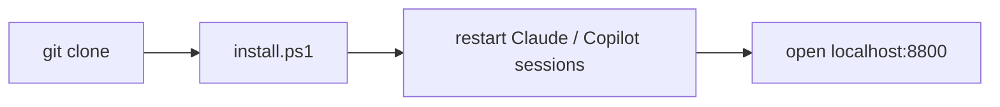

# AI day tracker

Tracks your Claude Code and GitHub Copilot sessions and builds a local dashboard of where your workday went, with time per project and ticket, ready for Jira and Azure DevOps.

- **Calendar dashboard** at `http://localhost:8800`: click a day to see when you worked, hours per project and ticket, what you asked and what you committed.
- **Calculates once a day at 17:00** (Mon–Fri), and anytime you click **⟳ Refresh today**.
- **Everything stays on your PC.** Nothing is uploaded, and the dashboard only answers on `localhost`.

## Quick install

1. Install Python 3.10+ (`winget install Python.Python.3.12`).
2. Download the code (**Code → Download ZIP** on GitHub) and extract it.
3. Double-click `install.cmd`, then open `http://localhost:8800`.

Step by step, with troubleshooting: [docs/manuals/install.md](docs/manuals/install.md).

## Install from a terminal (5 minutes)

```powershell
git clone https://github.com/IvanCuric23/ai-day-tracker.git
cd ai-day-tracker
powershell -ExecutionPolicy Bypass -File .\install.ps1 -JiraUrl https://<your-jira>/browse/
```



- `-JiraUrl` is optional. Without it, Jira keys show as plain text instead of links.
- `install.cmd` runs the same `install.ps1`; options such as `-JiraUrl` can be added after it.
- Run it again any time, for example after `git pull`. It updates the scripts and keeps your data and settings.

## Prerequisites

| Need | Required? | How |
|---|---|---|
| Windows 10/11 | yes | — |
| Python 3.10+ | yes | `winget install Python.Python.3.12`. Only the standard library is used, so there's nothing to `pip install` |
| Git | recommended (without it only a warning; tickets and commits are missing) | your name and e-mail in `git config --global` (used to find your commits) |
| Claude Code and/or Copilot CLI | at least one | VS Code Copilot Chat history is read as well |
| Admin rights | **no** | everything installs for your user only |

## What it installs

| What | Where |
|---|---|
| Scripts, dashboard, your data | `%USERPROFILE%\.claude\clock\` |
| Clock hook + `tickets.json` | `%USERPROFILE%\.claude\hooks\` |
| Claude Code hooks | 4 entries added to `%USERPROFILE%\.claude\settings.json` (a backup is written first) |
| Copilot CLI hooks | `%USERPROFILE%\.copilot\hooks\clock.json` |
| Scheduled task **My AI day** | Mon–Fri 17:00: calculates yesterday and today |
| Scheduled task **My AI dashboard server** | every 5 min: keeps the dashboard running (also on battery) |

## How tickets are found

The tracker tries each source in order and uses the first one that gives a ticket:

1. **Branch name**: `feature/ABC-123-x` gives Jira `ABC-123`, `feature/116-x` gives Azure DevOps `#116`.
2. **The branch your commits that day were made on.**
3. **`tickets.json`**: for branches without a number, or a whole folder:
   ```json
   { "feature/NewPricing": "ABC-123", "project:MyRepoFolder": "ABC-200" }
   ```

Azure DevOps numbers link to the work item of the repo's own `dev.azure.com` remote automatically.

## Settings (`%USERPROFILE%\.claude\clock\config.json`)

| Key | Default | Meaning |
|---|---|---|
| `authors` | your git name + e-mail | whose commits count as yours |
| `jira_url` | empty | e.g. `https://jira.example.com/browse/` |
| `port` | `8800` | dashboard port (run `install.ps1` again after changing it) |
| `day_from` / `day_to` | `7` / `19` | working hours for the "day" view |
| `gap_minutes` | `10` | a pause longer than this counts as away |
| `reports_dir` | `~/Documents/DailyWorkReport/reports` | optional `work-log-YYYY-MM-DD.md` files, shown on the day page |

## How time is counted

- **Active time:** steps (prompts, tool calls, answers) less than 10 minutes apart are summed.
- **Parallel sessions** are counted once. The day's total is split between projects by their share.

## Uninstall

```powershell
powershell -ExecutionPolicy Bypass -File .\uninstall.ps1            # keeps your data
powershell -ExecutionPolicy Bypass -File .\uninstall.ps1 -RemoveData
```

## Troubleshooting

| Problem | Fix |
|---|---|
| `localhost:8800` doesn't load | Wait up to 5 min, or run `Start-ScheduledTask "My AI dashboard server"` |
| A day is empty | Click **⟳ Refresh today**, or run `python %USERPROFILE%\.claude\clock\my_day.py 2026-11-03 --no-open` |
| The 17:00 run failed | Read `%USERPROFILE%\.claude\clock\days\last-run.log` |
| Commits are missing | Check `authors` in `config.json` |

## Development

```powershell
python -m venv .venv
.venv\Scripts\python -m pip install -r requirements-dev.txt
.venv\Scripts\python -m ruff check .
.venv\Scripts\python -m pytest
```

Tests use invented data in a temporary folder and never read your real Claude Code or Copilot history.
