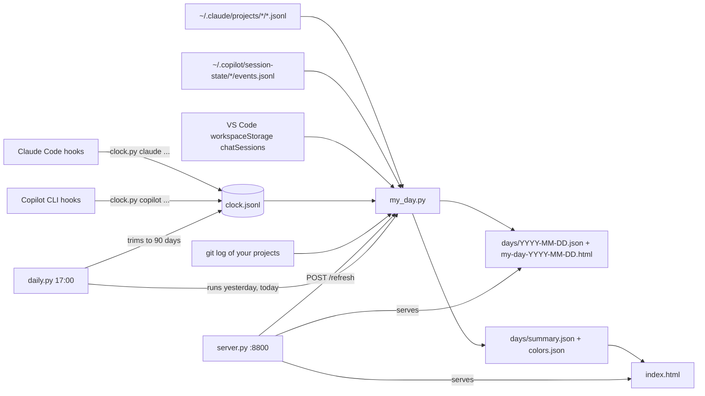

# How AI day tracker works

For maintainers. Everything is Python standard library; the installed copy lives in `%USERPROFILE%\.claude\clock\`
(scripts, data) and `%USERPROFILE%\.claude\hooks\` (the hook).

## Data flow

## Components

| File (in `src/`) | Role |
|---|---|
| `hooks/clock.py` | The hook. One JSON line per event appended to `clock.jsonl` (path: `CLOCK_FILE` env var, else `~/.claude/clock/clock.jsonl`). Never prints, never fails. `clock.py backfill <date>` rebuilds a day's lines from Claude history. Errors go to `clock.log` beside the log. |
| `hooks/tickets.example.json` | Template for `tickets.json` (branch or `project:<folder>` to ticket), read by the hook and `my_day.py`. |
| `clock/my_day.py` | Builds one day (`today`, `yesterday` or a date): reads the three histories, `clock.jsonl` and git commits, writes the day files, then rebuilds `summary.json`, `colors.json` and `index.html`. Config: `config.json` (authors, Jira URL, port, day hours, `reports_dir`). |
| `clock/server.py` | Local server on `127.0.0.1:<port>` (default 8800). `GET /`, `/days/<file>`, `/worklogs`, `/worklog/<date>`, `/search?q=`; `POST /refresh[?day=]` runs `my_day.py`. A second copy cannot bind the port and exits. |
| `clock/daily.py` | The 17:00 run: builds `yesterday` then `today`, then trims `clock.jsonl`. Writes `days/last-run.log`. |
| `setup_hooks.py` | Adds or removes the hooks (see below). Called by the installer scripts. |
| `install.ps1`, `uninstall.ps1` | Copy `src\clock\*` to the clock folder and `hooks\clock.py` to the hooks folder, write `config.json` if missing, call `setup_hooks.py`, register the tasks, back-fill the last days, start the server. Uninstall keeps your data unless `-RemoveData`. |
| `*_template.html` | `my_day_template.html` (day page) and `dashboard_template.html` (calendar); data is injected into them. |

## Hook events

| Tool | Host event | `clock.py` event | Written |
|---|---|---|---|
| Claude Code | `SessionStart` | `start` | `how` = start source |
| Claude Code | `UserPromptSubmit` | `prompt` | `ask` = prompt text (200 chars) |
| Claude Code | `Stop` | `stop` | `did`, `model`, `commit`, `changed` |
| Claude Code | `SessionEnd` | `end` | `how` = reason |
| Copilot CLI | `sessionStart` / `userPromptSubmitted` / `sessionEnd` | `start` / `prompt` / `end` | as above |
| Copilot CLI | `postToolUse` | `work` | a heartbeat on every tool call; **no git call**, so `branch` is empty |

- Every other line carries `branch` from `git rev-parse`; `my_day.py` takes a session's branch (and project, ticket)
  from its last non-empty value, so the empty `work` branch costs nothing.
- Claude Code has no per-tool hook here; its `work` lines only come from `backfill`.
- Claude hooks are merged into `~/.claude/settings.json` (backup first); Copilot's go to `~/.copilot/hooks/clock.json`.

## Scheduled tasks

| Task | When | Runs |
|---|---|---|
| My AI day | Mon-Fri 17:00 | `daily.py` (via `pythonw`) |
| My AI dashboard server | every 5 min, no time limit | `server.py` (a running copy makes the new one exit) |

## What is written where

| Path (under `%USERPROFILE%\.claude\clock\`) | By | Content |
|---|---|---|
| `clock.jsonl`, `clock.log` | hook | live session lines; hook errors |
| `days/<date>.json`, `days/my-day-<date>.html` | `my_day.py` | one day |
| `days/summary.json`, `days/colors.json`, `index.html` | `my_day.py` | calendar data, fixed colour per project, the calendar page |
| `days/last-run.log` | `daily.py` | outcome of the builds and the trim |
| `config.json`, `hooks\tickets.json` | installer / you | settings, ticket rules (kept on reinstall) |

## The 90-day trim

After the builds, `daily.py` rewrites `clock.jsonl` without the lines whose `time` is older than 90 days
(`CLOCK_KEEP_DAYS`): it writes `clock.jsonl.tmp` and `os.replace`s it. Lines it cannot parse are kept. An `OSError`
is logged to `last-run.log` and never fails the run. The reason: the log only grows, and `my_day.py` reads it whole
on every build.
