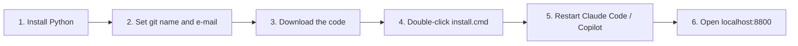

# Install AI day tracker (beginner guide)

Takes about 5 minutes. No admin rights needed: everything installs for your Windows user only.



## 1. Install Python (required) and Git (recommended)

Open **PowerShell** (Start menu, type `PowerShell`) and paste:

```powershell
winget install Python.Python.3.12
winget install Git.Git
```

- Python 3.10 or newer is required. Nothing else needs installing (no `pip`).
- Git is optional for the installer: without it you only get a warning, hours still work, but tickets from branch names and commits are missing.
- Close PowerShell and open a new one afterwards, so the new programs are found.
- Some installers may show a Windows elevation prompt; if you cannot approve it, the install fails and you should ask IT ([WinGet docs](https://learn.microsoft.com/windows/package-manager/winget/)).

## 2. Tell Git who you are (once)

The tracker finds your commits by your Git name and e-mail. Use the same ones you commit with:

```powershell
git config --global user.name "Your Name"
git config --global user.email "you@example.com"
```

Skip this and commits are not matched (the installer warns: `No git user.name/user.email`).

## 3. Get the code

The repository is public: <https://github.com/IvanCuric23/ai-day-tracker>

**Option A: Download ZIP (no Git or GitHub account needed)**

1. On the page above click **Code**, then **Download ZIP**.
2. Right-click the ZIP, **Extract All...**, and open the extracted folder (it contains `install.cmd`).

**Option B: git clone**

```powershell
git clone https://github.com/IvanCuric23/ai-day-tracker.git
cd ai-day-tracker
```

## 4. Install

Double-click **`install.cmd`** in that folder. A window shows the steps and stays open at the end (`pause`) until you press a key.

- If Windows asks "Do you want to open this file?" or shows a SmartScreen warning for a downloaded file, choose **Open** / **Run anyway**. This is Windows' normal warning for files from the internet.
- Optional, to make Jira keys like `ABC-123` into links: open PowerShell in the folder and run
  ```powershell
  .\install.cmd -JiraUrl https://<your-jira>/browse/
  ```
  Anything you add after `install.cmd` is passed on to `install.ps1`. Without it, Jira keys show as plain text.
- Equivalent PowerShell line: `powershell -ExecutionPolicy Bypass -File .\install.ps1 -JiraUrl https://<your-jira>/browse/`

About the "blocked ZIP" question: `install.cmd` starts PowerShell with `-ExecutionPolicy Bypass`, and Microsoft documents that `Bypass` blocks nothing and does not check the zone of a script ([about_Execution_Policies](https://learn.microsoft.com/powershell/module/microsoft.powershell.core/about/about_execution_policies)). So you normally do not need to unblock anything. Not tested here: if your company policy (Group Policy) overrides this and install fails with a "cannot be loaded" / "not digitally signed" error, right-click the ZIP before extracting, **Properties**, tick **Unblock**, **OK**, then extract again ([Unblock-File](https://learn.microsoft.com/powershell/module/microsoft.powershell.utility/unblock-file)).

## 5. After the install

1. Restart Claude Code / Copilot CLI sessions that were already open, so they load the hooks.
2. Open <http://localhost:8800> (the installer opens it for you). Bookmark it.

The first build covers the last 7 days of your existing history. The day is recalculated every weekday at 17:00, or any time with the **Refresh today** button.

## Update

Cloned with git: double-click `update.cmd` (it pulls the new code and runs the installer). Downloaded a ZIP: get the [latest release](https://github.com/IvanCuric23/ai-day-tracker/releases/latest), extract it and double-click `install.cmd` again. Scripts are updated; your data, `config.json` and `tickets.json` are kept.

## Uninstall

- Double-click **`uninstall.cmd`**: removes the scheduled tasks, stops the dashboard and removes the hooks. Your data stays.
- Also delete your data: from PowerShell in the folder, run `.\uninstall.cmd -RemoveData`.

## If something goes wrong

| What you see | Fix |
|---|---|
| `Python 3.10 or newer was not found.` | Run `winget install Python.Python.3.12`, open a **new** terminal, run `install.cmd` again. The Microsoft Store `python.exe` stub is ignored on purpose. |
| `git not found: hours still work, but tickets ...` | Only a warning. Run `winget install Git.Git` and install again to get tickets and commits. |
| `No git user.name/user.email: commits will not be matched.` | Do step 2, then run `install.cmd` again. Or set `authors` in `%USERPROFILE%\.claude\clock\config.json`. |
| `the dashboard did not answer on http://localhost:8800/ yet` | Wait a minute and reload. Or run `Start-ScheduledTask "My AI dashboard server"` (it also restarts itself every 5 minutes). |
| `localhost:8800` still does not load | Port may be taken: run `.\install.cmd -Port 8801`, then open `http://localhost:8801`. |
| A day is empty | Click **Refresh today**, or run `python %USERPROFILE%\.claude\clock\my_day.py 2026-11-03 --no-open` (use your date). |
| The 17:00 run failed | Read `%USERPROFILE%\.claude\clock\days\last-run.log`. |
| Hooks or the day build misbehave | Read `%USERPROFILE%\.claude\clock\clock.log`: the hook (`clock.py`) and `my_day.py` both write warnings and errors there. |
| Commits are missing | Check `authors` in `%USERPROFILE%\.claude\clock\config.json`. |

## What this page does not cover

- Settings, ticket matching and how time is counted: see the [README](../../README.md).
- Checked against `install.ps1`, `install.cmd`, `uninstall.ps1` and `uninstall.cmd` on branch `feature/initial-version`. The install itself was not run to write this page.
- `winget` package IDs: `Git.Git` is shown in Microsoft's docs; `Python.Python.3.12` was checked with `winget show --id Python.Python.3.12` (Python Software Foundation, 3.12.10 on 2026-11-04). Any newer `Python.Python.3.x` works too; `winget search Python.Python` lists them.
